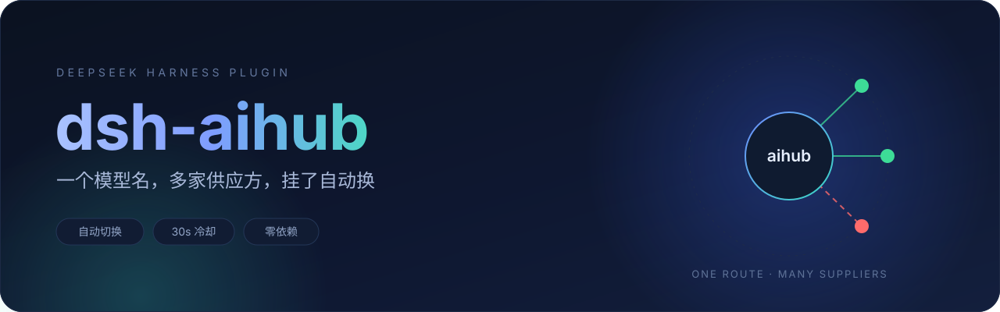
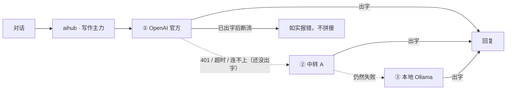

<div align="center">
  

  <h1>dsh-aihub</h1>

  <p><strong>一个模型名，背后压着多家 AI 供应方。<br>首选那条挂了，自动换下一条 —— 对话不中断。</strong></p>

  <p>
    <a href="https://github.com/wemebabo57-a11y/dsh-aihub/releases"></a>
    <a href="LICENSE"></a>
    
    
    
  </p>
</div>

---

现在的 AI 入口通常不止一个：官方 API、朋友给的中转、公司网关、本地 Ollama。它们的模型名不一样、额度和账单也不一样，但在对话里你只想要「一个能用的模型」。

**dsh-aihub 是 DeepSeek Harness 的一个 LLM 供应方插件**：你按**用途**建模型（写作主力 / 看图 / 便宜货），每个模型下面按顺序填几组「供应方 + 真实模型 id」。模型选择器里只出现一个供应方 `aihub`，下面全是你自己起的名字。谁先挂，就自动换下一个。

```
             ┌──────────────────────────────┐
  对话 ────▶ │  aihub ·「写作主力」          │
             └──────────────┬───────────────┘
                            │ ① 先试
              ┌─────────────▼─────────────┐
              │ OpenAI 官方（gpt-5）       │── 401 / 超时 / 连不上 ──┐
              └───────────────────────────┘                        │
                            │ ② 自动换（还没出字才换）                │
              ┌─────────────▼─────────────┐                        │
              │ 中转 A（gpt-5）            │◀───────────────────────┘
              └───────────────────────────┘
                            │ ③ 再失败
              ┌─────────────▼─────────────┐
              │ 本地 Ollama（qwen3:32b）   │── 全挂 ──▶ 汇总报错
              └───────────────────────────┘
```

## ✨ 特性

| | |
|---|---|
| 🔁 **自动切换** | 首响应超时 / 401 / 5xx / 断连 / SSE 里第一个 error，都算「这条不行」，换下一条 |
| ⏱ **30 秒冷却** | 刚失败的供应方排到链尾，下一轮不再先等它一次超时；它仍在链上，恢复后自动回到你排的顺序 |
| 🧩 **两种协议** | OpenAI 兼容（`/chat/completions`）与 Anthropic 兼容（`/messages`）混着填 |
| 🖼 **多模态** | 勾了「视觉」才真发图；取不到图也不报错，降级成文字占位 |
| 🛠 **工具调用 / 思考块** | 按两家线格式原样映射，agent 能正常读写文件、跑命令 |
| 🎛 **专门设置页** | 设置里单独一页「AI Hub」，不混进原生表单；一屏建模型、填供应方、保存 |
| 🪶 **零运行时依赖** | 只接 DSH 自己的 `llm` / `attachments` / `settings` 服务 |
| 🔐 **不泄密** | 日志只写供应方标签、模型、状态码，任何诊断都不打印 API Key |

## 🚀 安装

要求：DeepSeek Harness **0.2.1 或更新**（已在 `0.2.1-rc.2` 实测），Node **≥ 22.19**。

### DSH 插件管理界面

设置 → 插件 → 安装，输入下面任意一种：

- Git 仓库：`wemebabo57-a11y/dsh-aihub`
- 本地目录：把仓库克隆下来后填绝对路径

装完**重启**应用。

### 命令行

```powershell
# 跟 main 走（有更新重装即可）
dsh plugin --profile web add "github:wemebabo57-a11y/dsh-aihub"

# 钉住某个发行版
dsh plugin --profile web add "github:wemebabo57-a11y/dsh-aihub#v0.1.0"

# 或者下发行版压缩包再装
dsh plugin --profile web add "file:./dsh-aihub-0.1.0.tgz"

# 桌面版把 web 换成 desktop
dsh plugin --profile desktop add "github:wemebabo57-a11y/dsh-aihub"
```

装完重启 DSH。改代码联调时用 `link:` 装本地目录，改完跑 `npm run build:ui` 再刷新页面。

## ⚡ 30 秒上手

1. 打开 **设置 → AI Hub**
2. **新建模型**，填显示名（模型选择器里看到的就是它）
3. 在卡片里填第一家供应方：协议、Base URL、真实模型 id、API Key
4. 点 **+ 添加供应方**，再加一家兜底
5. **保存** → 回到对话页，模型选择器里 `aihub` 组下就有它

> 保存后模型选择器会自动刷新，不需要重启或刷新页面。

## 🧩 供应方怎么填

| 场景 | 协议 | Base URL | 模型 id |
| --- | --- | --- | --- |
| OpenAI 官方 | `openai-completions` | `https://api.openai.com/v1` | `gpt-5` |
| DeepSeek 官方 | `openai-completions` | `https://api.deepseek.com/v1` | `deepseek-chat` |
| 各类中转 | `openai-completions` | 中转给的 `…/v1` | 中转文档里的 id |
| Anthropic 官方 | `anthropic-messages` | `https://api.anthropic.com` | `claude-sonnet-4-5` |
| 本地 Ollama | `openai-completions` | `http://127.0.0.1:11434/v1` | `qwen3:32b` |

- **顺序就是优先级**：列表里的第一行先试，可以上下移动、随时停用。
- **API Key 可以不填**：写 `env:OPENAI_API_KEY` 就从环境变量读，密钥不落盘。
- **额外请求头**（组织号、租户、网关鉴权）放在「高级」里的 `headers`，一行一个 `Name: value`。
- 同一个模型下，几家供应方的**真实模型 id 可以不同**（比如官方的 `gpt-5` 和中转的 `gpt-5-2026-01`），只要它们对你来说是同一个「用途」。

## 🔁 切换规则

**只在「一个字都还没吐给对话」之前切换。** 一旦开始输出，就不换供应方了——否则两家的文字会接在一起，谁也没法回滚。这时如实报错，你重发即可。



- **首响应超时** 30s，**流空闲超时** 120s，都可被宿主的调用超时覆盖。
- **全部失败**时，报错汇总每个供应方的失败原因（多于 4 个保留首尾），代码取最后一个失败的类型。
- **取消**（用户点停止）立刻结束，保留已经收到的内容。
- **自愈**：失败只影响排序 30 秒；你保存一次设置，所有失败记忆立刻清空，下一轮按你的顺序重来。

## ⚙️ 设置项

每个模型：

| 字段 | 说明 | 默认 |
| --- | --- | --- |
| 显示名 | 模型选择器里显示的文字 | — |
| 上下文窗口 | 告诉宿主这个模型的上下文预算 | `128000` |
| 输出上限 | 单次回复的最大 token，会作为 `max_tokens` 发出去 | `8192` |
| 视觉 | 勾了才把图片真正发给上游 | 否 |

每个供应方：

| 字段 | 说明 |
| --- | --- |
| 标签 | 只用于界面和日志，方便你认出是哪条线路 |
| 协议 | `openai-completions` 或 `anthropic-messages` |
| Base URL | 到 `/v1` 为止（Anthropic 写到域名即可，自动补 `/v1/messages`） |
| 模型 id | 供应方侧的真实 id |
| API Key | 明文，或 `env:变量名` |
| 启用 | 临时停用而不删除 |
| headers | 可选，额外请求头 |

## 🏗 它是怎么做到的

DSH 的 LLM 层允许插件注册自己的供应方路由。本插件注册了一条固定路由 `aihub`：

- **Host 半身**（`src/index.mjs`）把设置里的 JSON 变成模型目录，实现 `listModels` / `resolveModel` / `prepareCall`，并负责切换、超时、SSE 翻译。
- **浏览器半身**（`src/client/*`）通过 `configForms` 读写同一个设置项，只做本地草稿 + 保存。
- 持久化只有一个字符串字段 `state`（一段 JSON），写在 profile 的 `cordis.patch.yml` 里；写入前 Host 会再校验一遍，坏文档退化成空目录而不是让宿主崩掉。

```
设置页 ──(form.set JSON)──▶ 配置层 ──▶ 适配器(listModels) ──▶ 模型选择器
                                    └─▶ prepareCall ─▶ 供应商 1 ─▶ 供应商 2 …
```

## 🔐 关于密钥

DSH 的插件配置是**明文落盘**的：API Key 会写进 profile 的 `cordis.patch.yml`（同类插件一样）。介意的话用 `env:变量名` 形式，把密钥留在环境变量里：

```yaml
apiKey: env:OPENAI_API_KEY
```

插件本身不会把 Key 写进日志、报错或任何返回给前端的数据。

## ❓ FAQ

**Q：为什么模型选择器里看不到 `aihub`？**
设好至少一个模型并保存后才会出现（空目录不显示）。刚装完需要重启一次。

**Q：为什么第二个供应方永远不生效？**
检查它是否被停用、模型 id 是否写对；再看不切换是不是因为**已经出字了**——那种情况设计上不换。

**Q：切过去的中转提示要用别的模型名？**
每家供应方各自填自己的真实 id，互不影响。

**Q：能同时装 `llm-pi-ai` 之类的其它供应方插件吗？**
可以，`aihub` 是独立的一条路由，和它们并列出现在选择器里。

**Q：图表/图片发不出去？**
模型卡片里勾上「视觉」；上游不支持时图片会变成 `[image not sent: …]` 的占位文本，不会让整轮失败。

## 🛠 开发

```bash
node scripts/build-ui.mjs          # 打包浏览器半身 → client/client.js
node scripts/build-ui.mjs --check  # 校验产物是否过期
node scripts/check-ui.mjs          # 浏览器半身自检（假 React 渲染、文案、草稿规则）
node --test --test-isolation=none test/host/*.test.mjs   # Host 逻辑测试（69 个）
```

- 零运行时依赖，测试离线跑（`fetch` 用假实现注入）。
- `docs/contract.md` 是两个半身之间的唯一契约，改行为先改它。
- 目录：`src/host/` 适配器与状态编解码；`src/client/` 设置页；`scripts/` 打包与自检；`test/` 用例。

欢迎 issue / PR。提交前请让上面三条命令全绿。

## English

**dsh-aihub** is a DeepSeek Harness plugin that exposes one LLM route (`aihub`) whose models are defined by you: each model can be served by several OpenAI-compatible or Anthropic-compatible endpoints, tried in your order, with automatic failover before any token is emitted (30s cooldown on the failed endpoint). Install with `dsh plugin --profile web add "github:wemebabo57-a11y/dsh-aihub"`, create a model in **Settings → AI Hub**, and it shows up under the `aihub` provider in the model picker.

## License

[MIT](LICENSE) © 2026 dsh-aihub contributors
